# Integration of Northern Eagle and Adaptive t-distribution Sparrow Optimization Algorithm, extremely effective! Highly recommended! MATLAB code

The Sparrow Search Algorithm (SSA) was introduced in 2020 and has since been widely applied across various fields. The design inspiration for the Sparrow Search Algorithm comes from the biological characteristics of birds. The mathematical model built on the foraging behavior of sparrows can be categorized as a Discoverer-Follower Model, with an added alarm mechanism. The SSA algorithm is attractive to many researchers due to its ease of implementation and fast speed. However, the SSA algorithm still faces challenges such as difficulty in finding the optimal solution, search reliance on an elite population, and susceptibility to local optima.

This issue introduces a new algorithm: the Northern Eagle-Adaptive t-distribution Sparrow Optimization Algorithm (NTSSA), which is a shortened version of the original Sparrow Search Algorithm. This abbreviation is just for differentiation purposes; please feel free to modify it according to your own ideas.

The integration of the Northern Eagle algorithm is the result of careful consideration of the original Sparrow Search Algorithm, followed by multiple adjustments and extensive research over time. The code organization is not easy, so take care and cherish it. Without further ado, let's discuss the improvement strategy.

Improvement Strategy Details

Point 1: Integrating the Northern Eagle's Exploration Phase Positioning Strategy
To enhance the exploration capability of the Discoverer Model in the search space and improve the solving performance in optimization problems, we replaced the R2<ST position update formula used in the initial phase of discovery with the Northern Eagle's exploration phase position update formula.
The rationale behind this change is that during each iteration's initial stage, one discoverer often quickly converges to the global optimal solution, thus demonstrating strong development capabilities. However, this approach often neglects exploring the surrounding search space, leading to a severe shortage of exploration during the global expansion phase and tending towards local optima. By adopting the Northern Eagle's updating strategy, which involves random selection of prey in the search space, we can enhance the exploration capability of the SSA algorithm.
The Northern Eagle's exploration phase position update formula is:

Point 2: Adaptive t-distribution Mutation Strategy
Regarding the adaptive t-distribution strategy, this has also been mentioned in previous articles. This strategy can greatly enhance the convergence speed of the algorithm.
In the follower phase of the Sparrow Algorithm, a t-distribution perturbation mutation is performed at a certain probability. This not only does not change the original update principle formula of the Sparrow Algorithm but also enables the Sparrow Algorithm to have a good global exploration capability in the early iterations and a good local search capability in the later iterations, thereby accelerating the convergence speed of the Sparrow Algorithm.
The specific position update method is as follows:
Among them, t(C_iter) has undergone variation.
Improvement point 3: Adding Bernoulli chaotic mapping to increase diversity in the Sparrow Algorithm
Adding Bernoulli chaotic mapping mainly increases the diversity of initialization for the Sparrow Algorithm. Those who want to replace it with other chaotic mappings can refer to this article: 10 Chaotic Mapping Optimization Grey Wolf Algorithm, which can be switched on one click.
Bernoulli chaotic mapping, formula as follows:
The following two diagrams can appear when running plotchaos.m.
These three strategies each have their own use! And each strategy is complementary, indispensable!
Improvement highlights
① The program can be run automatically, generating statistical tables.
Each algorithm runs 30 times, and an Excel table can be automatically generated in the current directory. In addition to calculating the average, best value, standard deviation, worst value, median value for each algorithm, there is another table specifically for counting rank sum tests.
② No change in algorithm complexity
The algorithm introduced this time will not call the fitness function multiple times in the loop, without adding so-called greedy strategies or reverse learning methods that add complexity.
③ Comparative experiments with various intelligent algorithms
This algorithm was compared with four efficient or popular intelligent algorithms in this session. These include: the original Sparrow Algorithm (SSA), the Beetle Algorithm (DBO), the Grey Wolf Optimization Algorithm (GWO), and the Northern Eagle Optimization Algorithm (NGO).
Results display
Tested in CEC2005: Each algorithm runs 500 times, with a population set to 30.
Here are some screenshots showing the excellent test results of the CEC2005 function.
Each algorithm is iterated 500 times, with a population size set to 30, and each function is run 30 times to calculate the optimal value, standard deviation, mean, worst value, median, and five other indicators such as rank sum test results and box plots.
F1Function calculation results: \nNTSSA: Optimal value:0 Standard deviation:0 Mean:2.4487e-264 Median:6.0217e-297 Worst value:7.346e-263\nDBO: Optimal value:4.7633e-166 Standard deviation:3.1542e-97 Mean:5.7588e-98 Median:6.9473e-135 Worst value:1.7276e-96\nNGO: Optimal value:5.738e-90 Standard deviation:4.1173e-87 Mean:1.8453e-87 Median:4.3969e-88 Worst value:2.1893e-86\nSSA: Optimal value:0 Standard deviation:1.0921e-54 Mean:1.9951e-55 Median:3.371e-81 Worst value:5.9819e-54\nGWO: Optimal value:2.9248e-29 Standard deviation:8.1727e-28 Mean:7.8522e-28 Median:5.5404e-28 Worst value:3.2544e-27\nF2Function calculation results: \nNTSSA: Optimal value:2.218e-172 Standard deviation:1.3489e-135 Mean:2.4887e-136 Median:1.3881e-150 Worst value:7.3908e-135\nDBO: Optimal value:1.5703e-81 Standard deviation:1.5102e-53 Mean:2.7573e-54 Median:1.2293e-70 Worst value:8.272e-53\nNGO: Optimal value:7.021e-47 Standard deviation:2.0815e-45 Mean:1.4974e-45 Median:6.3103e-46 Worst value:8.5487e-45\nSSA: Optimal value:0 Standard deviation:2.1123e-27 Mean:3.9018e-28 Median:6.8423e-37 Worst value:1.1573e-26\nGWO: Optimal value:2.1974e-17 Standard deviation:5.8398e-17 Mean:7.7607e-17 Median:5.1817e-17 Worst value:2.5636e-16\nF3Function calculation results: \nNTSSA: Optimal value:6.6952e-299 Standard deviation:0 Mean:1.2167e-225 Median:8.0736e-262 Worst value:3.5719e-224\nDBO: Optimal value:5.1011e-146 Standard deviation:2.4802e-49 Mean:4.5282e-50 Median:3.0561e-112 Worst value:1.3585e-48\nNGO: Optimal value:7.3707e-31 Standard deviation:6.6499e-21 Mean:1.3306e-21 Median:8.8755e-24 Worst value:3.6519e-20\nSSA: Optimal value:2.3399e-93 Standard deviation:1.4579e-23 Mean:2.6618e-24 Median:4.756e-36 Worst value:7.9853e-23\nGWO: Optimal value:4.104e-08 Standard deviation:4.4844e-05 Mean:1.4637e-05 Median:1.012e-06 Worst value:0.00024052\nF4Function calculation results: \nNTSSA: Optimal value:8.6675e-162 Standard deviation:1.7667e-113 Mean:3.2255e-114 Median:2.8467e-142 Worst value:9.6764e-113\nDBO: Optimal value:1.3239e-82 Standard deviation:9.0445e-50 Mean:1.6774e-50 Median:1.4166e-67 Worst value:4.9559e-49\nNGO: Optimal value:1.4133e-38 Standard deviation:1.9392e-37 Mean:1.8641e-37 Median:1.3118e-37 Worst value:8.6041e-37\nSSA: Optimal value:1.0861e-114 Standard deviation:3.2725e-27 Mean:5.9844e-28 Median:6.3272e-44 Worst value:1.7925e-26\nGWO: Optimal value:1.7578e-07 Standard deviation:2.4345e-06 Mean:9.9418e-07 Median:4.1139e-07 Worst value:1.3664e-05\nF5Function calculation results: \nNTSSA: Optimal value:1.5737e-19 Standard deviation:1.1117e-06 Mean:5.0902e-07 Median:7.9894e-11 Worst value:4.317e-06\nDBO: Optimal value:25.1597 Standard deviation:0.24236 Mean:25.769 Median:25.7883 Worst value:26.2928\nNGO: Optimal value:25.0399 Standard deviation:0.38697 Mean:25.8058 Median:25.8261 Worst value:26.7666\nSSA: Optimal value:2.1946e-09 Standard deviation:0.00011449 Mean:3.6999e-05 Median:9.6678e-07 Worst value:0.00059907\nGWO: Optimal value:25.9708 Standard deviation:0.71277 Mean:27.0682 Median:27.0909 Worst value:28.5502\nF6Function calculation results: \nNTSSA: Optimal value:2.3842e-24 Standard deviation:3.8056e-13 Mean:7.0955e-14 Median:4.4563e-19 Worst value:2.0857e-12\nDBO: Optimal value:5.9127e-06 Standard deviation:0.041085 Mean:0.0078301 Median:0.00014741 Worst value:0.22535\nNGO: Optimal value:9.2805e-07 Standard deviation:0.00049172 Mean:0.00027211 Median:1.6357e-05 Worst value:0.0018643\nSSA: Optimal value:2.2624e-16 Standard deviation:1.9703e-11 Mean:8.3951e-12 Median:1.3183e-12 Worst value:1.0598e-10\nGWO: Optimal value:0.24885 Standard deviation:0.29782 Mean:0.78479 Median:0.75158 Worst value:1.5066\nF7Function calculation results: \nNTSSA: Optimal value:9.1441e-05 Standard deviation:0.00064115 Mean:0.00072213 Median:0.00047314 Worst value:0.0024197\nDBO: Optimal value:9.4393e-05 Standard deviation:0.00091153 Mean:0.0011641 Median:0.001081 Worst value:0.0045568\nNGO: Optimal value:0.00012218 Standard deviation:0.00035454 Mean:0.00069541 Median:0.00058364 Worst value:0.001531\nSSA: Optimal value:3.218e-05 Standard deviation:0.0010267 Mean:0.0017187 Median:0.0016299 Worst value:0.0043961\nGWO: Optimal value:0.00058692 Standard deviation:0.00097913 Mean:0.0020562 Median:0.0020771 Worst value:0.0047868\nF8Function calculation results: \nNTSSA: Optimal value:-12569.4866 Standard deviation:1678.515 Mean:-10451.1684 Median:-9819.5086 Worst value:-8208.4829\nDBO: Optimal value:-12222.1301 Standard deviation:1972.8794 Mean:-8315.7348 Median:-7494.4121 Worst value:-6071.1764\nNGO: Optimal value:-8194.1607 Standard deviation:474.0859 Mean:-7437.0833 Median:-7534.9128 Worst value:-6427.7209\nSSA: Optimal value:-9760.3177 Standard deviation:600.3155 Mean:-8598.3574 Median:-8622.1659 Worst value:-7266.9474\nGWO: Optimal value:-7320.4867 Standard deviation:600.1397 Mean:-6087.7259 Median:-6162.8539 Worst value:-5100.9283\nF9Function calculation results: \nNTSSA: Optimal value:0 Standard deviation:0 Mean:0 Median:0 Worst value:0\nDBO: Optimal value:0 Standard deviation:0.72662 Mean:0.13266 Median:0 Worst value:3.9798\nNGO: Optimal value:0 Standard deviation:0 Mean:0 Median:0 Worst value:0\nSSA: Optimal value:0 Standard deviation:0 Mean:0 Median:0 Worst value:0\nGWO: Optimal value:0 Standard deviation:3.2819 Mean:2.0311 Median:2.558e-13 Worst value:9.6945\nF10Function calculation results: \nNTSSA: Optimal value:4.4409e-16 Standard deviation:0 Mean:4.4409e-16 Median:4.4409e-16 Worst value:4.4409e-16\nDBO: Optimal value:4.4409e-16 Standard deviation:0 Mean:4.4409e-16 Median:4.4409e-16 Worst value:4.4409e-16\nNGO: Optimal value:3.9968e-15 Standard deviation:1.7702e-15 Mean:5.4179e-15 Median:3.9968e-15 Worst value:7.5495e-15\nSSA: Optimal value:4.4409e-16 Standard deviation:0 Mean:4.4409e-16 Median:4.4409e-16 Worst value:4.4409e-16\nGWO: Optimal value:7.5051e-14 Standard deviation:1.5404e-14 Mean:1.0134e-13 Median:9.992e-14 Worst value:1.3545e-13\nF11Function calculation results: \nNTSSA: Optimal value:0 Standard deviation:0 Mean:0 Median:0 Worst value:0\nDBO: Optimal value:0 Standard deviation:0.003148 Mean:0.00057475 Median:0 Worst value:0.017242\nNGO: Optimal value:0 Standard deviation:0 Mean:0 Median:0 Worst value:0\nSSA: Optimal value:0 Standard deviation:0 Mean:0 Median:0 Worst value:0\nGWO: Optimal value:0 Standard deviation:0.0034541 Mean:0.00090182 Median:0 Worst value:0.015013\nF12Function calculation results: \nNTSSA: Optimal value:1.8932e-32 Standard deviation:1.269e-16 Mean:2.3613e-17 Median:2.1048e-22 Worst value:6.9541e-16\nDBO: Optimal value:1.5266e-07 Standard deviation:0.0015418 Mean:0.00034054 Median:2.9786e-06 Worst value:0.0084239\nNGO: Optimal value:1.9257e-07 Standard deviation:0.001198 Mean:0.00024015 Median:2.4687e-06 Worst value:0.0065767\nSSA: Optimal value:2.3003e-16 Standard deviation:4.2474e-11 Mean:8.6696e-12 Median:3.461e-13 Worst value:2.3343e-10\nGWO: Optimal value:0.019073 Standard deviation:0.021546 Mean:0.04447 Median:0.040303 Worst value:0.10467\nF13Function calculation results: \nNTSSA: Optimal value:1.1546e-29 Standard deviation:1.274e-14 Mean:2.3842e-15 Median:1.1823e-21 Worst value:6.9829e-14\nDBO: Optimal value:5.5406e-05 Standard deviation:0.47286 Mean:0.55624 Median:0.37375 Worst value:1.5904\nNGO: Optimal value:0.0094832 Standard deviation:0.17502 Mean:0.24457 Median:0.19172 Worst value:0.64407\nSSA: Optimal value:3.8888e-15 Standard deviation:1.1059e-10 Mean:3.8039e-11 Median:2.5836e-12 Worst value:5.7651e-10\nGWO: Optimal value:0.18385 Standard deviation:0.27035 Mean:0.57197 Median:0.53991 Worst value:1.0552\nF14Function calculation results: \nNTSSA: Optimal value:0.998 Standard deviation:0.60541 Mean:1.1964 Median:0.998 Worst value:2.9821\nDBO: Optimal value:0.998 Standard deviation:1.8098 Mean:1.4559 Median:0.998 Worst value:10.7632\nNGO: Optimal value:0.998 Standard deviation:0 Mean:0.998 Median:0.998 Worst value:0.998\nSSA: Optimal value:0.998 Standard deviation:4.7056 Mean:3.859 Median:0.998 Worst value:12.6705\nGWO: Optimal value:0.998 Standard deviation:3.8605 Mean:4.365 Median:2.9821 Worst value:12.6705\nF15Function calculation results: \nNTSSA: Optimal value:0.00030749 Standard deviation:0.00019233 Mean:0.00040628 Median:0.00030749 Worst value:0.0012232\nDBO: Optimal value:0.00030749 Standard deviation:0.00040232 Average:0.00077246 Median:0.00073137 Worst value:0.0022368\nNGO: Optimal value:0.00030749 Standard deviation:6.0974e-06 Mean:0.00030875 Median:0.00030749 Worst value:0.00034097\nSSA: Optimal value:0.00030749 Standard deviation:3.4e-08 Mean:0.00030749 Median:0.00030749 Worst value:0.00030767\nGWO: Optimal value:0.00030751 Standard deviation:0.0095675 Mean:0.0070606 Median:0.00044344 Worst value:0.020363\nF16Function calculation results: \nNTSSA: Optimal value:-1.0316 Standard deviation:5.0499e-16 Mean:-1.0316 Median:-1.0316 Worst value:-1.0316\nDBO: Optimal value:-1.0316 Standard deviation:6.2532e-16 Mean:-1.0316 Median:-1.0316 Worst value:-1.0316\nNGO: Optimal value:-1.0316 Standard deviation:6.4539e-16 Mean:-1.0316 Median:-1.0316 Worst value:-1.0316\nSSA: Optimal value:-1.0316 Standard deviation:5.0499e-16 Mean:-1.0316 Median:-1.0316 Worst value:-1.0316\nGWO: Optimal value:-1.0316 Standard deviation:1.889e-08 Mean:-1.0316 Median:-1.0316 Worst value:-1.0316\nF17Function calculation results: \nNTSSA: Optimal value:0.39789 Standard deviation:0 Mean:0.39789 Median:0.39789 Worst value:0.39789\nDBO: Optimal value:0.39789 Standard deviation:0 Mean:0.39789 Median:0.39789 Worst value:0.39789\nNGO: Optimal value:0.39789 Standard deviation:0 Mean:0.39789 Median:0.39789 Worst value:0.39789\nSSA: Optimal value:0.39789 Standard deviation:0 Mean:0.39789 Median:0.39789 Worst value:0.39789\nGWO: Optimal value:0.39789 Standard deviation:5.0589e-06 Mean:0.39789 Median:0.39789 Worst value:0.3979\nF18Function calculation results: \nNTSSA: Optimal value:3 Standard deviation:8.2385 Mean:5.7 Median:3 Worst value:30\nDBO: Optimal value:3 Standard deviation:3.2246e-15 Mean:3 Median:3 Worst value:3\nNGO: Optimal value:3 Standard deviation:1.01e-15 Mean:3 Median:3 Worst value:3\nSSA: Optimal value:3 Standard deviation:4.9295 Mean:3.9 Median:3 Worst value:30\nGWO: Optimal value:3 Standard deviation:14.7885 Mean:5.7 Median:3 Worst value:84.0001\nF19Function calculation results: \nNTSSA: Optimal value:-3.8628 Standard deviation:2.2554e-15 Mean:-3.8628 Median:-3.8628 Worst value:-3.8628\nDBO: Optimal value:-3.8628 Standard deviation:0.0029875 Mean:-3.8615 Median:-3.8628 Worst value:-3.8549\nNGO: Optimal value:-3.8628 Standard deviation:2.6823e-15 Mean:-3.8628 Median:-3.8628 Worst value:-3.8628\nSSA: Optimal value:-3.8628 Standard deviation:2.2704e-15 Mean:-3.8628 Median:-3.8628 Worst value:-3.8628\nGWO: Optimal value:-3.8628 Standard deviation:0.0028267 Mean:-3.8612 Median:-3.8627 Worst value:-3.8549\nF20Function calculation results: \nNTSSA: Optimal value:-3.322 Standard deviation:0.051146 Mean:-3.2943 Median:-3.322 Worst value:-3.2031\nDBO: Optimal value:-3.322 Standard deviation:0.14086 Mean:-3.2255 Median:-3.2625 Worst value:-2.6381\nNGO: Optimal value:-3.322 Standard deviation:9.4743e-11 Mean:-3.322 Median:-3.322 Worst value:-3.322\nSSA: Optimal value:-3.322 Standard deviation:0.060328 Mean:-3.2665 Median:-3.322 Worst value:-3.2031\nGWO: Optimal value:-3.322 Standard deviation:0.076006 Mean:-3.2587 Median:-3.322 Worst value:-3.1333\nF21Function calculation results: \nNTSSA: Optimal value:-10.1532 Standard deviation:5.4999e-15 Mean:-10.1532 Median:-10.1532 Worst value:-10.1532\nDBO: Optimal value:-10.1532 Standard deviation:2.5512 Mean:-7.2766 Median:-5.1008 Worst value:-5.0552\nNGO: Optimal value:-10.1532 Standard deviation:6.113e-06 Mean:-10.1532 Median:-10.1532 Worst value:-10.1532\nSSA: Optimal value:-10.1532 Standard deviation:2.1907 Mean:-8.9591 Median:-10.1532 Worst value:-5.0552\nGWO: Optimal value:-10.1531 Standard deviation:2.179 Mean:-8.9695 Median:-10.1511 Worst value:-5.0552\nF22Function calculation results: \nNTSSA: Optimal value:-10.4029 Standard deviation:8.0799e-16 Mean:-10.4029 Median:-10.4029 Worst value:-10.4029\nDBO: Optimal value:-10.4029 Standard deviation:2.7911 Average:-8.027 Median:-10.3948 Worst value:-2.7659\nNGO: Optimal value:-10.4029 Standard deviation:7.413e-09 Mean:-10.4029 Median:-10.4029 Worst value:-10.4029\nSSA: Optimal value:-10.4029 Standard deviation:2.2865 Mean:-9.1627 Median:-10.4029 Worst value:-5.0877\nGWO: Optimal value:-10.4027 Standard deviation:1.8889 Mean:-9.793 Median:-10.4008 Worst value:-2.7515\nF23Function calculation results: \nNTSSA: Optimal value:-10.5364 Standard deviation:1.616e-15 Mean:-10.5364 Median:-10.5364 Worst value:-10.5364\nDBO: Optimal value:-10.5364 Standard deviation:2.8156 Mean:-8.7632 Median:-10.5364 Worst value:-1.8595\nNGO: Optimal value:-10.5364 Standard deviation:1.6201e-06 Mean:-10.5364 Median:-10.5364 Worst value:-10.5364\nSSA: Optimal value:-10.5364 Standard deviation:2.3264 Mean:-9.2746 Median:-10.5364 Worst value:-5.1285\nGWO: Optimal value:-10.5362 Standard deviation:1.7469 Mean:-10.0856 Median:-10.5349 Worst value:-2.4216\nFive indicators can be converted to one-clickEXCELTable:   
Rank sum test result:
Box plot:
Contains a program for plotting (plotCEC2005_Main.m) and a program for generating statistical indicators in Excel and box plots (runsCEC2005_Main.m) as well as a program for drawing chaos map graphs (plotchaos.m).
After running, it directly generates a table, where result.xls is the optimal value, standard deviation, mean, worst value, median indicator statistical results, and rank sum result.xls is the rank sum test result.
Some code snippets are shown below:

## Images

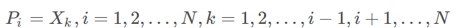
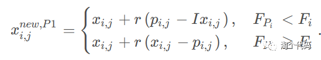

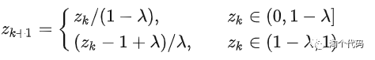
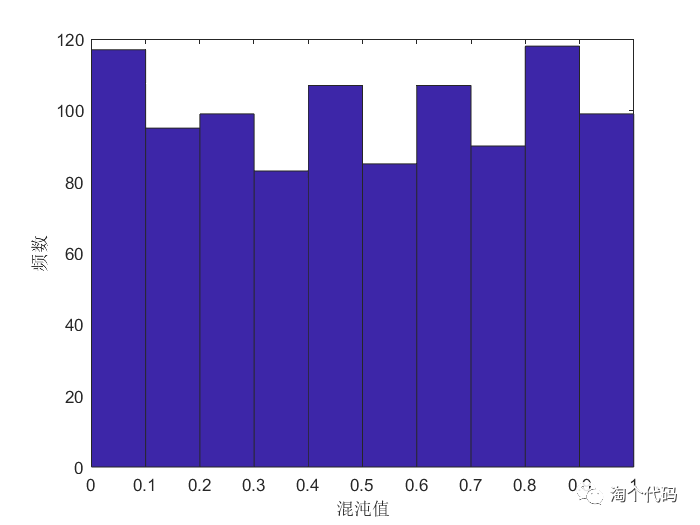
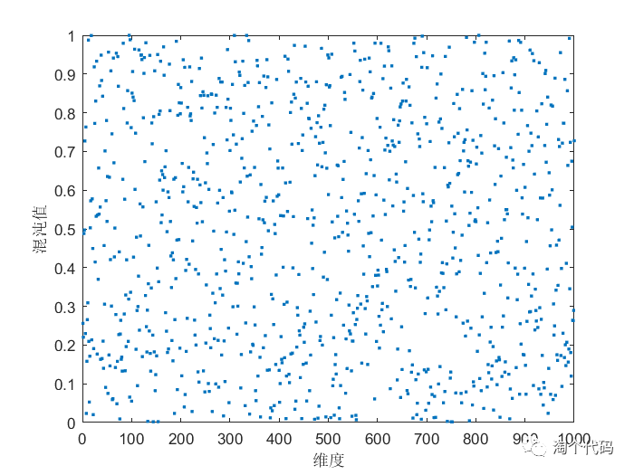
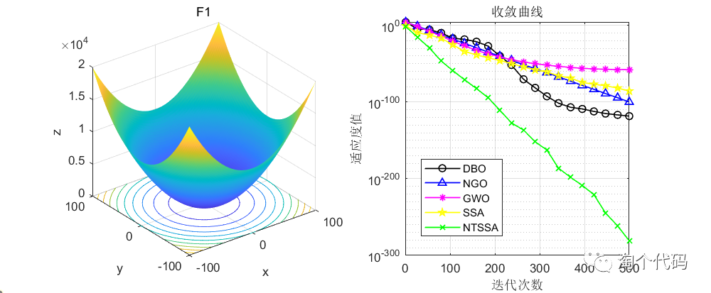
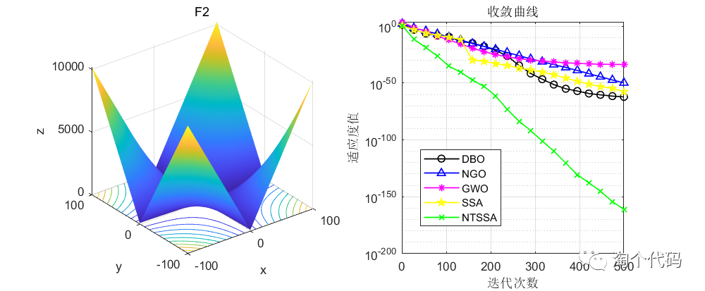
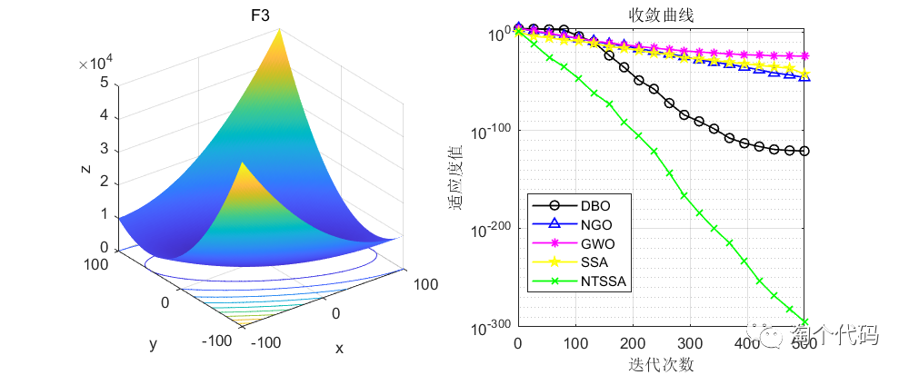
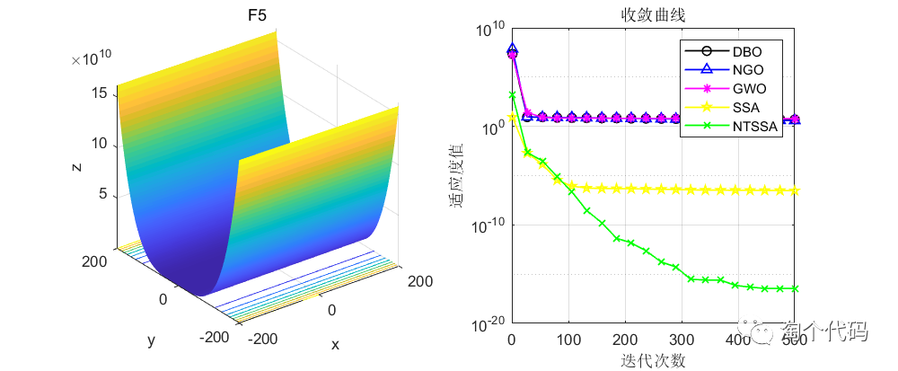
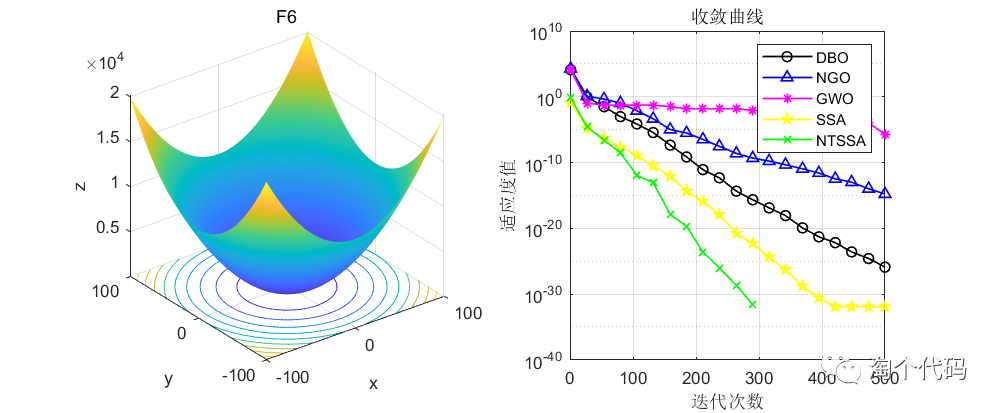
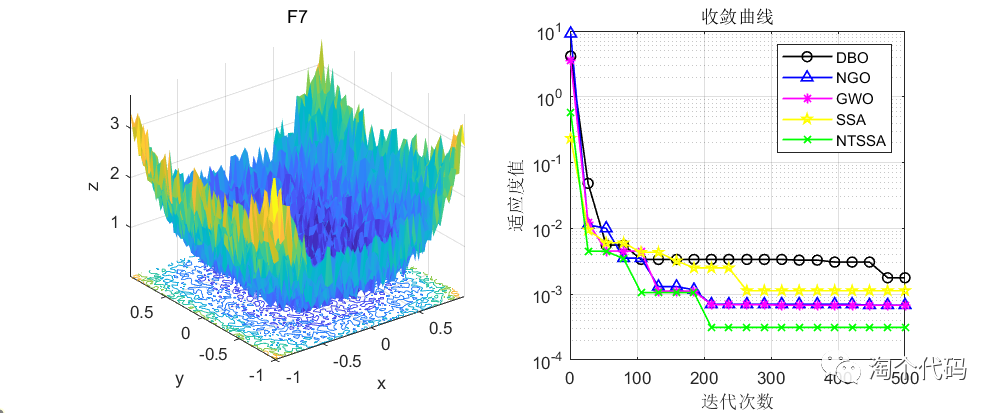
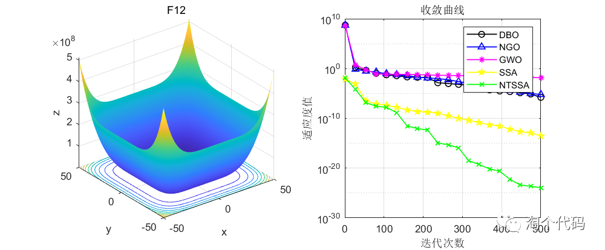
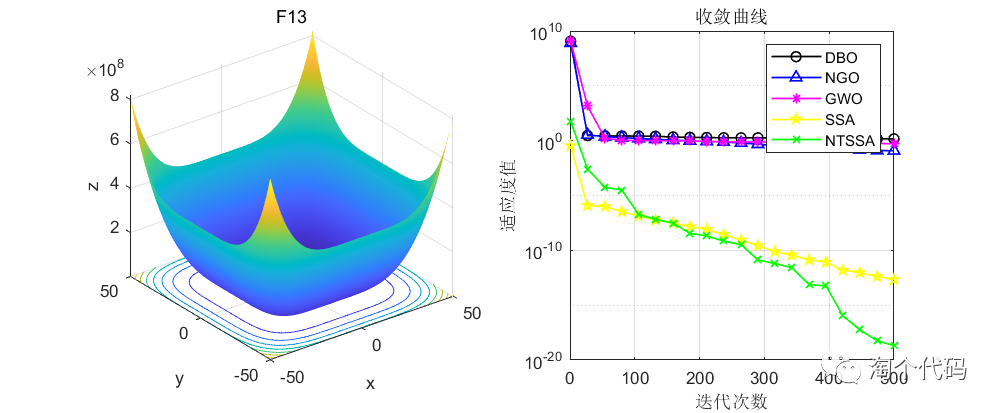
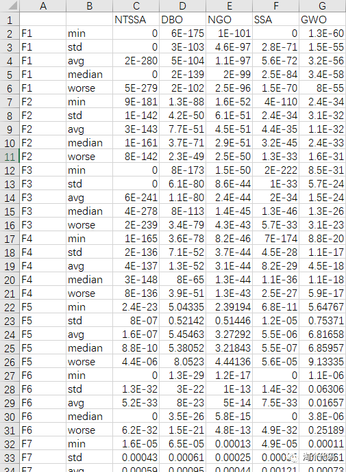
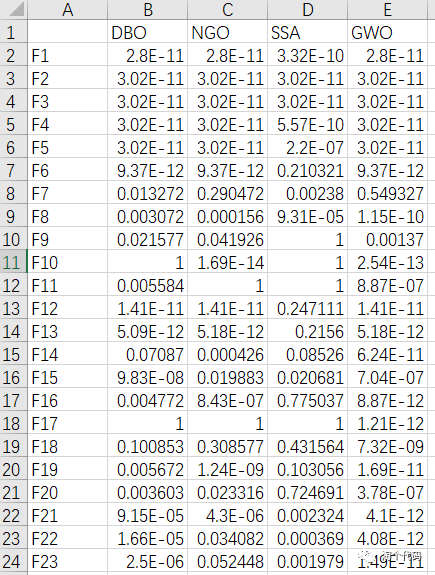
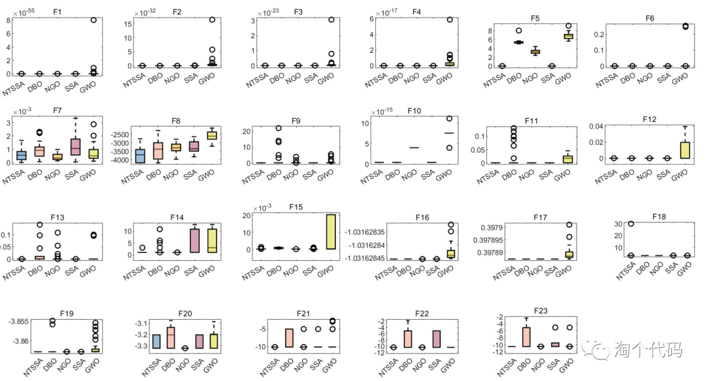

<!-- PAYMENT_BLOCK -->

## Get this dataset

- Payment link (Stripe): [Buy now](https://buy.stripe.com/3cs8yP7sY87d0vu9AB)
- Payment QR code: 

<!-- /PAYMENT_BLOCK -->
